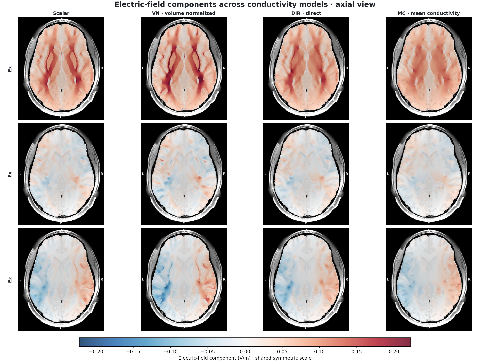
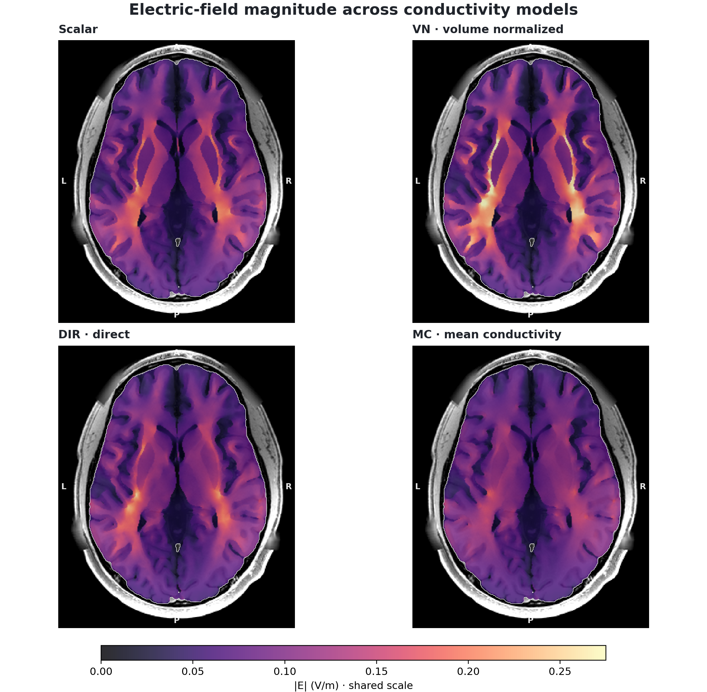

<div align="center">

# dwi2cond-xp

面向 SimNIBS 4.6 的跨平台 DTI 电导率建模流程，运行时无需 FSL。

[](https://github.com/ayakacxy/dwi2cond-xp/releases/tag/v0.1.0)
[](https://github.com/ayakacxy/dwi2cond-xp/actions/workflows/ci.yml)
[](https://github.com/ayakacxy/dwi2cond-xp/actions/workflows/codeql.yml)
[](https://scorecard.dev/viewer/?uri=github.com/ayakacxy/dwi2cond-xp)
[](#-验证概览)
[](pyproject.toml)
[](docs/zh/SIMNIBS_INTEGRATION.md)
[](LICENSE)

[English](README.md) · [文档](docs/zh/README.md) · [验证](docs/zh/VALIDATION.md) · [性能测试](docs/zh/BENCHMARKS.md) · [更新记录](docs/zh/CHANGELOG.md)

🧠 **DTI 拟合** · ⚡ **运行时无 FSL** · 🧭 **张量重定向** · ⚡ **各向异性 FEM** · 🧪 **100% 语句覆盖**

</div>

`dwi2cond-xp` 将已预处理的扩散 MRI 转换为 SimNIBS 4.6 电导率张量，并组织各向异性有限元仿真。项目使用 Python，主运行流程不依赖 FSL。

这是独立社区项目，不是 SimNIBS 或 FSL 的官方发行版。

> **历史版本。** 本文档对应 2026-08-21 发布的 `v0.1.0`。该标签曾于 2026-08-29 因文档和发布元数据修正而重新发布，算法源码保持原始 `v0.1.0` 实现。以下结果适用于本版本所述的输入和处理步骤。

## ⚡ 验证概览

| 检查项目 | 结果 | 测试条件 |
| --- | ---: | --- |
| Python 测试 | **144 passed · 100.00%** | `v0.1.0` 发布记录：覆盖全部 1,644/1,644 条包语句，包括配置在本机的 FSL 参考测试 |
| DTI 张量对照 | **相对 L2 误差 4.18e-6** | 历史私有 HCP b0+b1000 数据，使用相同 WLS 和梯度非线性设置，对照 FSL 6.0.4 |
| DTI 拟合耗时 | **9.76 s 对比 108.23 s · 11.09x** | 历史单服务器、单输入的拟合与输出计时，不代表完整流程加速 |
| 电导率对照 | **最大绝对差 0 至 2.22e-16** | 历史合成球形网格上与 SimNIBS 4.6 对照，覆盖 `vn`、`dir`、`mc` |
| 固定电极配置 FEM | **4/4 模式完成** | 历史私有被试的 `scalar`、`vn`、`dir`、`mc` C3→C4 仿真，使用 Pardiso |

仓库不分发解剖影像、被试标识、体素派生数据或被试级机器可读产物。方法及验证细节见[验证](docs/zh/VALIDATION.md)和[性能测试](docs/zh/BENCHMARKS.md)。

## 🧭 支持范围

预处理完成后的流程为：

```text
已预处理的单壳 DWI 或六分量扩散张量
  -> 加权最小二乘 DTI 拟合与质量检查
  -> 显式映射并重定向至 CHARM T1 网格
  -> scalar / vn / dir / mc 电导率
  -> SimNIBS 4.6 固定电极配置 FEM
  -> 向量电场 NIfTI 与质量检查报告
```

本项目不负责原始 DWI 的运动、涡流、磁敏感性/topup/场图校正，也不自动估计 6/12 自由度或非线性 DTI→T1 配准。这些步骤需由外部预处理流程完成，包括同步旋转 b 向量。当前版本未实现非线性 PPD 张量重定向。

纯 Python DTI 与张量映射部分依赖 NumPy、SciPy、NiBabel、h5py 和 tqdm。网格电导率、有限元和先导场计算固定要求 SimNIBS 4.6.0；这些功能仅适用于能够安装并验证该 SimNIBS 版本的平台。

## 🧩 电导率模式

| 模式 | 含义 |
| --- | --- |
| `scalar` | 每种组织使用固定标量电导率，不使用 DTI。 |
| `vn` | 在保护阈值内保留张量方向和各向异性比，并逐位置根据组织参考电导率归一化行列式。 |
| `dir` | 保留方向、各向异性比和空间幅值变化；默认在全部所选各向异性组织之间共用一个全局缩放系数。 |
| `mc` | 使用与 `dir` 相同的全局缩放系数，再将每个张量替换为保持局部行列式的各向同性张量，用于强度变化对照。 |

所选各向异性组织中的精确全零张量会先替换为该组织的标量电导率张量，因此是可接受的输入。默认 `dir`/`mc` 校准要求各组织的加权平均行列式为正且有限。`--no-correct-intensity` 跳过全局校准，仍执行逐张量保护规则。`v0.1.0` 没有公开的 `strict-fsl`/`robust` 拟合模式切换。本版本的公式和退化张量处理见[方法](docs/zh/METHODS.md)。

## 🐍 安装

完整流程已在 Python 3.11 与 SimNIBS 4.6.0 环境中验证。推荐安装到现有 SimNIBS 4.6 环境；若需保持其依赖不变，可使用 `--no-deps` 安装 wheel：

```bash
conda activate simnibs
python -c "import simnibs; assert simnibs.__version__ == '4.6.0'"
python -m pip install --no-deps dwi2cond_xp-0.1.0-py3-none-any.whl
dwi2cond-xp --help
```

从当前源码开发时，将 wheel 安装命令替换为 `python -m pip install --no-deps -e .`。发布 wheel 曾以临时附加安装的方式与参考环境中的 SimNIBS 4.6.0 一起导入验证，该验证没有修改参考环境。

也可以另建独立环境：

```bash
conda env create -f environment.yml
conda activate dwi2cond-xp-simnibs46
python -m pip install -e .
python -c "import simnibs; assert simnibs.__version__ == '4.6.0'"
dwi2cond-xp --help
```

仅安装纯 Python 核心：

```bash
python -m venv .venv
. .venv/bin/activate              # Windows PowerShell: .venv\Scripts\Activate.ps1
python -m pip install --upgrade pip
python -m pip install .
dwi2cond-xp --help
```

允许更新依赖的开发环境可执行：

```bash
python -m pip install -e '.[test]'
pytest -q --cov=dwi2cond_xp --cov-report=term-missing --cov-fail-under=100
ruff check src tests tools scripts
```

## 📥 输入文件与坐标

DWI 输入应为已预处理的四维 NIfTI，并配有一致的 b 值、b 向量和扩散脑掩膜。DTI 模型使用一个非零壳层加 b=0 体积。可选的梯度非线性系数 `grad_dev` 采用 FSL/HCP 九分量排列。

张量输入也为四维 NIfTI，最后一维依次为 `Dxx,Dxy,Dxz,Dyy,Dyz,Dzz`。映射至 T1 前，必须选择以下一种方式：

- 通过 `--world-transform` 提供外部估计的 4×4 仿射矩阵，从输入世界坐标映射到参考世界坐标；
- 仅在外部预处理已对齐扩散与 T1 世界坐标时，指定 `--assume-aligned`。

最终张量按 SimNIBS 4.6 的要求保存到 `m2m_<subject>/DTI_coregT1_tensor.nii.gz`。坐标、掩膜及输入检查见[输入文件与坐标](docs/zh/INPUTS.md)。

## 🚀 最小流程

拟合预处理后的单壳 DWI：

```bash
dwi2cond-xp fit-dti \
  preprocessed_dwi.nii.gz bvals bvecs brain_mask.nii.gz tensor_dwi.nii.gz \
  --grad-dev grad_dev.nii.gz \
  --workers 8 \
  --valid-mask-out tensor_valid_mask.nii.gz \
  --qa-json tensor_fit_qa.json
```

将张量映射到 CHARM T1 网格。下面示例使用 `--assume-aligned` 的前提是外部流程已完成对齐：

```bash
dwi2cond-xp register-tensor \
  tensor_dwi.nii.gz m2m_subject/T1.nii.gz \
  m2m_subject/DTI_coregT1_tensor.nii.gz \
  --source-mask tensor_valid_mask.nii.gz \
  --assume-aligned \
  --qa-json tensor_registration_qa.json
```

检查 C3→C4 各向异性仿真配置，暂不启动求解器：

```bash
dwi2cond-xp simulate-tdcs m2m_subject simulation_outputs \
  --mode vn \
  --anode C3 --cathode C4 --current-ma 1 \
  --shape rect --dimensions 50 50 --thickness 4 \
  --solver pardiso --volume-tissues 1 2 3 \
  --cpus 8 --dry-run
```

移除 `--dry-run` 后执行 SimNIBS。`scalar`、`vn`、`dir`、`mc` 分别运行，各有独立的输出目录和清单。各向异性模式缺少张量时会报错，不会自动改用 `scalar`。

每次正式仿真在 T1 网格上输出一个向量电场 NIfTI，最后一维为 `Ex,Ey,Ez`，模长通过 `sqrt(Ex^2 + Ey^2 + Ez^2)` 计算。体数据仅保留白质、灰质和脑脊液标签 `1,2,3`，严格排除颅骨、头皮、电极及颅外组织。

## 🎨 体素电场对比

```bash
dwi2cond-xp compare-fields \
  scalar_E.nii.gz vn_E.nii.gz dir_E.nii.gz mc_E.nii.gz \
  m2m_subject/T1.nii.gz m2m_subject/final_tissues.nii.gz \
  electric_field_xyz_3x4.png \
  --view components --plane axial --mask-labels 1 2 3
```

分量图按三行（`Ex`、`Ey`、`Ez`）、四列（`scalar`、`vn`、`dir`、`mc`）排列，并共用一个对称色标。切片根据脑掩膜面积最大的位置选择，不根据场强选取。



模长图使用相同的四份向量 NIfTI，并共用一个正值色标：



## ⚡ 先导场

`simulate-leadfield` 为四种电导率模式构建 SimNIBS 4.6 `TDCSLEADFIELD` 配置，保留原始 HDF5 来源信息，并可导出形状为 `(N_spatial * 3, N_electrode - 1)` 的 NumPy 矩阵及 JSON 元数据。电极帽的第一个电极为参考电极，其余每列对应一个 1 A 基。默认使用 Pardiso，求解失败时不会自动改用其他求解器。

该接口及 HDF5/NPY 格式已通过单元测试，但 `v0.1.0` 的验证不包含真实被试的完整全电极先导场运行。详见 [SimNIBS 集成](docs/zh/SIMNIBS_INTEGRATION.md)。

## 🧪 历史验证结果

`v0.1.0` 发布验证使用过一名私有 HCP 被试。仓库不分发原始影像、体数据派生物、被试标识或被试级机器可读产物；仅提供两张已渲染、无被试标识的电场对比 PNG 作为结果展示。使用这些图片需保留 HCP 致谢；图片的公开展示不替代接受 [WU-Minn HCP 开放数据使用条款](https://hcp-db.humanconnectome.org/study/hcp-young-adult/document/wu-minn-hcp-consortium-open-access-data-use-terms)。

- b0+b1000 DTI 拟合包含 881,299 个掩膜内体素，881,194 个有效，105 个无效体素被明确填零并记录。
- 与 FSL 6.0.4 的 WLS 加梯度非线性校正比较，HCP 张量相对 L2 误差为 `4.18e-6`，平均和 p99 绝对差分别为 `4.78e-10`、`2.10e-9`。
- 同一服务器、同一输出范围下，16 个 worker 的 Python 拟合耗时 9.76 s，FSL 6.0.4 为 108.23 s，耗时比 `11.09x`。这是单机 DTI 拟合结果，不代表完整 FEM 流程的加速。
- 合成网格上与 SimNIBS 4.6 比较，`vn` 的电导率最大绝对差为 `0`，`dir`/`mc` 为 `2.22e-16`。
- 真实 `scalar`、`vn`、`dir`、`mc` C3→C4 FEM 均由 Pardiso 完成；所有向量电场 NIfTI 数值有限，并严格排除白质、灰质、脑脊液以外的组织。
- 发布记录中的本机测试为 `144 passed`，语句覆盖率为 `100.00%`。跨平台 CI 要求相同的 100% 覆盖率；仅在没有 `dtifit` 时跳过 FSL 对照。

方法、计时范围和限制见[验证](docs/zh/VALIDATION.md)、[性能测试](docs/zh/BENCHMARKS.md)及[复现](docs/zh/REPRODUCIBILITY.md)。2026-08-29 的文档维护没有重跑私有 HCP、球形网格或 FEM 实验。

## 🗂️ 文档与社区

- [文档目录](docs/zh/README.md)
- [方法](docs/zh/METHODS.md)
- [参与贡献](docs/zh/CONTRIBUTING.md)
- [安全与医学数据报告](docs/zh/SECURITY.md)
- [获取帮助](docs/zh/SUPPORT.md)
- [行为准则](docs/zh/CODE_OF_CONDUCT.md)
- [更新记录](docs/zh/CHANGELOG.md)
- [第三方声明](THIRD_PARTY_NOTICES.zh-CN.md)

## 🙏 引用与许可证

请按照 [CITATION.cff](CITATION.cff) 引用本软件，并引用 SimNIBS 及上游使用的扩散处理软件。本项目采用 [GPL-3.0-only](LICENSE)；第三方软件包与可选参考工具保留各自许可证。

部分验证数据由 WU-Minn Human Connectome Project 提供。该项目由 David Van Essen 和 Kamil Ugurbil 领导，获得 NIH Blueprint 资助及华盛顿大学 McDonnell Center for Systems Neuroscience 支持。引用要求见 [HCP 官方引用说明](https://hcp-db.humanconnectome.org/study/hcp-young-adult/document/hcp-citations)。
